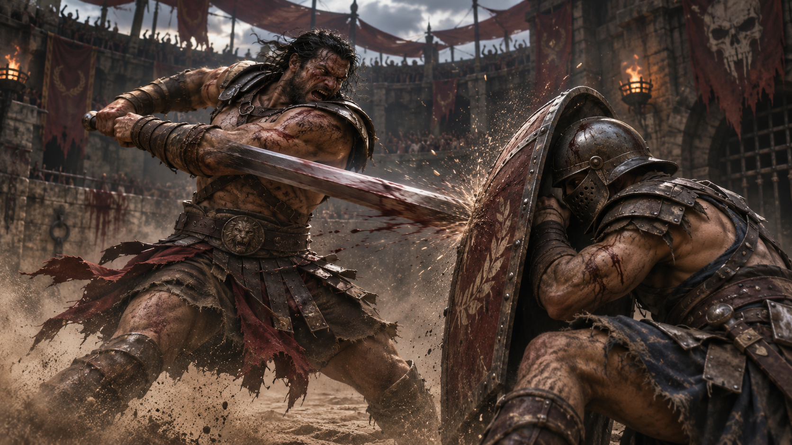

# The Long Vigil · Idle Game

*An independent grimdark idle gladiator RPG and open browser-game engineering project.*

The Long Vigil is the playable game in the Idle Game hobby project. Fight automatically in the arena, earn coins and experience, and train a seven-character Battle Group. Choose a path, let time pass and return when it suits you.

**This project is actively evolving.** Mechanics, content, visuals and long-term plans may change as ideas are tested. The current build is an experiment, not a promise of a fixed final feature set.

## Play the current alpha

- **[Play in your browser](https://janisp123.github.io/idle_game/play/)**
- **[Visit the project website](https://janisp123.github.io/idle_game/)**

The playable alpha is an experimental test build. Expect changes, rough edges and ongoing balancing. Progress is stored **locally in your browser** and alpha saves may be reset; there are no online accounts, multiplayer or cross-device save synchronization. This is not a production-ready game.

## The game

- **Fight and specialize.** Choose your equipment and develop a fighting style. Weapons, armour and terrain shape the outcome of automatic arena battles.
- **Build your character.** Train skills, grow attributes, earn rewards and improve your equipment. Specialization brings strengths as well as weaknesses.
- **Coins and combat experience.** Victories earn coins; fighting trains active classes and shared stats. Equipment upgrades use coins.
- **Play at your own pace.** Your Battle Group fights while you are away. Rewards follow the frozen combat build and current XP cap; return to activate earned levels.

The Long Vigil is an evolving idle RPG, not a fixed feature list. The game is designed around meaningful choices, gradual progression and a grimdark atmosphere rather than constant attention. Mechanics, balance and content will change during development; the [mechanics handbook](docs/mechanics/README.md) and [changelog](docs/CHANGELOG.md) describe the current implementation.

## A Hobby, Not a Business

The Long Vigil is my first game and a personal hobby project, not a business model. I started it to learn more about coding and game development, explore new ideas and create something enjoyable.

My hope is to eventually turn it into a full-fledged game with reliable servers and a stable experience. If the project ever generates enough income to help cover hosting and development costs, that would help make this possible.

Development may be slow or irregular. Bugs, balance issues, unfinished features and loss of progress are possible. I cannot guarantee uninterrupted availability, preservation of progress or regular updates.

Constructive feedback is always welcome. Please remember that I develop this project in my free time.

## Open engineering library

The repository also hosts a public collection of research, examples and practical lessons from building browser games. Some techniques are useful as general references even when they are not chosen for Idle Game.

| Resource | What it covers |
| --- | --- |
| [Engineering research](docs/RESEARCH_LIBRARY.md) | Topics and evidence for browser-game development |
| [Implementation examples](docs/USEFUL_EXAMPLES.md) | Algorithms, trade-offs and reusable patterns |
| [Mechanics handbook](docs/mechanics/README.md) | Current implemented rules and tuning references |
| [Design notes](docs/BRAINSTORM.md) | Explorations and possibilities, not commitments |
| [Owner decisions](docs/DECISIONS.md) | Agreed project direction and boundaries |
| [Active tasks](docs/TD_LIST.md) | Work currently tracked for development |
| [Working checkpoint](docs/WORK_CHECKPOINT.md) | Verified progress, limitations and handoffs |
| [Changelog](docs/CHANGELOG.md) | Completed changes and supporting evidence |

## Development and contributions

The source for the public website and browser alpha lives in `site/`. Changes are developed through reviewed pull requests with automated checks; the public site is deployed with GitHub Pages.

For project procedures, see [AGENTS.md](AGENTS.md) and the [agent protocol](docs/AGENT_PROTOCOL.md). Research notes are not authorization to implement features. The game is an ongoing hobby project, not a commercial launch announcement.

## License

The project's original code is released under the [MIT License](LICENSE.md). Any third-party materials, if incorporated, remain subject to their applicable terms.
